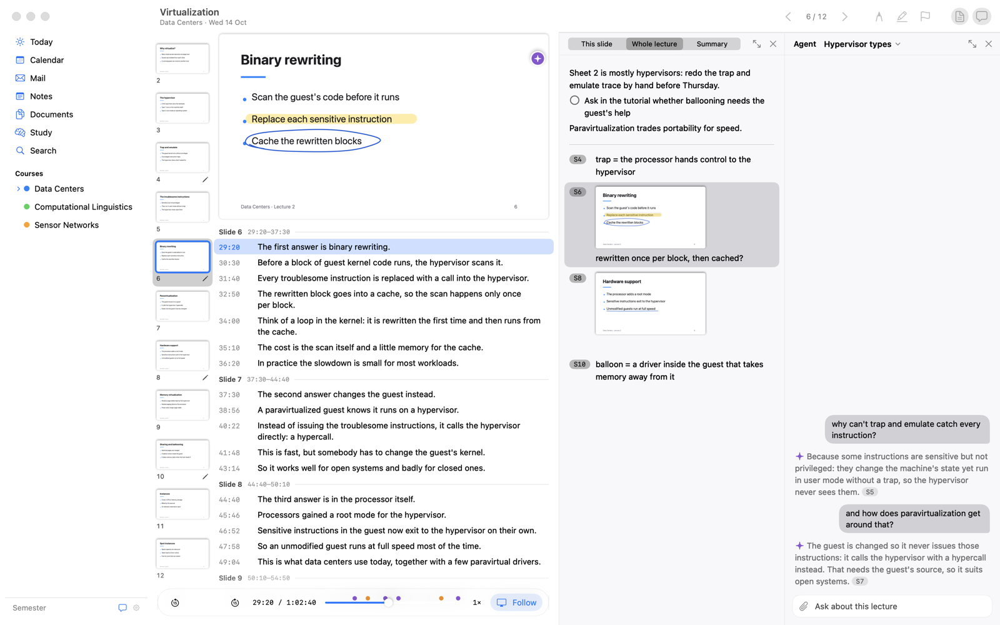
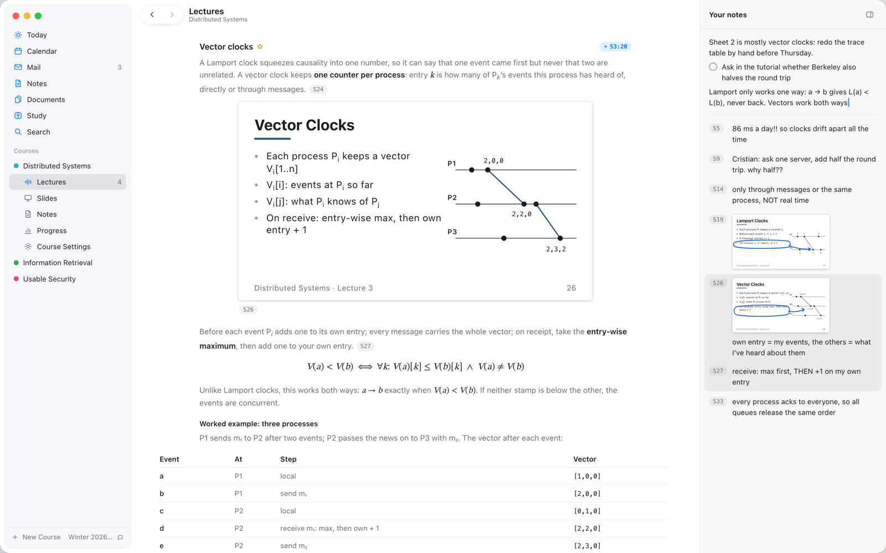
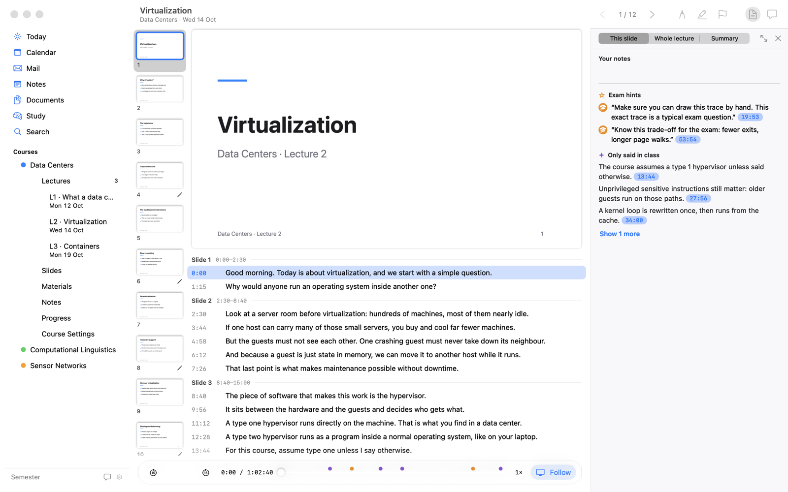
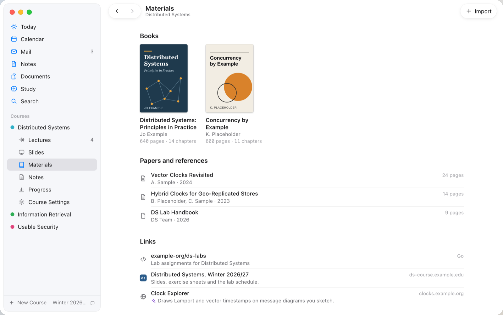
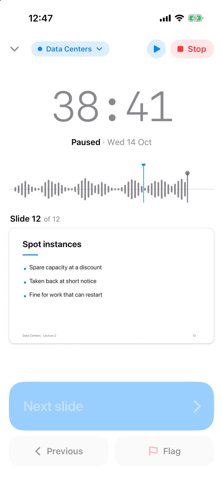

# Socrates

A study app for university lectures, for the Mac and the iPhone. You record a lecture with the slides open, and Socrates stamps every slide change on the recording, transcribes it on your Mac and lines the transcript up with the slides.

It started as one student's own tool. It works day to day, but this is version 0.1.



Review. Click a line of the transcript to hear it. Your notes for the lecture sit next to the agent, which is answering a question about the lecture.

<picture>
  <source media="(prefers-color-scheme: dark)" srcset="docs/images/notes-dark.png">
  
</picture>

A lecture's Summary, written by Claude from the slides and what was said, with your notes in a column beside it.



The "This slide" pane: exam hints and things only said in class, each linked to the moment it was said.



Each course keeps its books, papers and links.



The iPhone recorder, as a backup in the lecture hall.

## What it does

- Records the lecture on the Mac while you follow the slides. ←, → and Space change the slide and stamp the change on the audio clock.
- Transcribes the recording on the device with Whisper and aligns it to the slides.
- One agent (Claude) works across the app. It fixes transcripts, finds exam hints, files deadlines and answers with links to slides and times. Anything it changes can be undone.
- Reads mail from your own IMAP account for deadlines and room changes, and puts your classes in its own "Socrates" calendar. Claude drafts replies, but only you can press Send.

## Requirements

- A Mac with Apple silicon and macOS 26 (iOS 26 for the iPhone app).
- Xcode 26.5 or later and [XcodeGen](https://github.com/yonaskolb/XcodeGen).
- About 2 GB of free disk for the speech model, which downloads on first use.
- For the AI features: the [Claude Code](https://docs.anthropic.com/en/docs/claude-code) CLI, signed in with a Claude subscription. There is no API key. Without Claude Code the AI features are off; recording, transcription, review, notes, search, mail and the calendar still work.

## Build

```sh
xcodegen generate
xcodebuild -project Socrates.xcodeproj -scheme Socrates -destination 'platform=macOS' -skipMacroValidation build
```

To sign with your own team or turn on iCloud, copy `Config/Local.xcconfig.example` to `Config/Local.xcconfig` and fill it in (it is git-ignored). Without it the app is signed ad hoc and does not sync.

## Privacy

- Your library stays on your devices, in `~/Library/Application Support/Socrates` on the Mac. There is no telemetry and no server of the app's own.
- Claude never gets audio. When an AI feature runs, what it needs (a lecture's transcript and slide pages, a mail, a file you attach) goes to Claude through your CLI.
- iCloud sync is off until you set it up, and then uses your own private CloudKit database. The mail password is kept in the Keychain.

## License

MIT, see [LICENSE](LICENSE). Third-party code and models are listed in [THIRD_PARTY_NOTICES.md](THIRD_PARTY_NOTICES.md).
